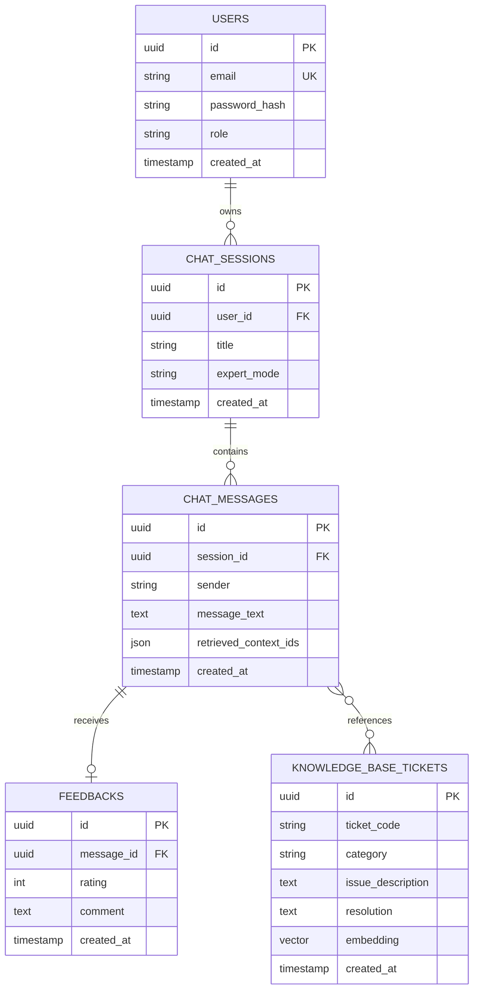
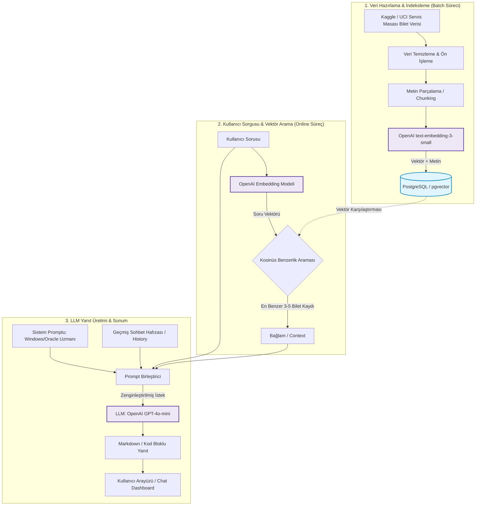

# Akıllı Servis Masası Chatbot

# ER DİYAGRAMI




```mermaid
flowchart TB
  subgraph HAZIRLIK["1. Veri hazırlama (bir kez ve Bilgi Merkezi yüklemesinde)"]
    K1["Kaggle ticket verisi (CSV)"]
    K2["Stack Exchange alt kümesi"]
    K3["Admin: Bilgi Merkezi dosya yükleme"]
    T["Temizle: HTML, yer tutucu, tekrar"]
    CH["Chunk'la"]
    EM["Embedding: multilingual-e5-base (passage: öneki)"]
    K1 --> T
    K2 --> T
    K3 --> T
    T --> CH --> EM
  end

  subgraph PGS["PostgreSQL (vektör deposu)"]
    PG[("document_chunks: metin + embedding")]
  end

  subgraph MSS["MSSQL (kullanıcı yönetimi ve loglama)"]
    USERS[("Users")]
    KD[("KnowledgeDocuments")]
    SESS[("ChatSessions, Messages, MessageSources")]
    FB[("Feedbacks")]
    AUD[("AuditLogs")]
  end

  subgraph SORU["2. Soru-cevap (her soruda)"]
    U["Kullanıcı: Streamlit chat"]
    API["FastAPI: JWT doğrulama"]
    MODE["Uzman modu: Genel, Windows Server, Oracle DB"]
    QE["Soru embedding: e5 (query: öneki)"]
    SR["Benzerlik araması: top-k"]
    PR["Prompt: sistem prompt + bağlam + sohbet geçmişi + soru"]
    LLM["LLM: OpenAI küçük model"]
    ANS["Cevap: Markdown, kod bloğu, kaynak bağlantısı"]
    SHOW["Ekranda gösterilir"]
    U --> API --> MODE --> QE --> SR --> PR --> LLM --> ANS --> SHOW
  end

  subgraph YONETIM["3. Geri bildirim ve yönetim"]
    PUAN["Kullanıcı cevabı puanlar"]
    ADM["Admin paneli: en çok sorulanlar, başarı oranı"]
  end

  EM -->|"vektör + metin"| PG
  K3 -->|"dosya kaydı (document_id)"| KD
  KD -.->|"aynı document_id ile senkron"| PG
  PG -->|"benzer parçalar"| SR
  API <-->|"kullanıcı ve rol"| USERS
  API -.->|"giriş ve hata kaydı"| AUD
  SESS -->|"son mesajlar"| PR
  ANS -->|"mesaj + kullanılan parçalar"| SESS
  SHOW --> PUAN
  PUAN -->|"puan"| FB
  FB --> ADM
  SESS --> ADM

  classDef proc fill:#EEEDFE,stroke:#534AB7,color:#26215C
  classDef db fill:#E1F5EE,stroke:#0F6E56,color:#04342C
  class K1,K2,K3,T,CH,EM,U,API,MODE,QE,SR,PR,LLM,ANS,SHOW,PUAN,ADM proc
  class PG,USERS,KD,SESS,FB,AUD db

  ```