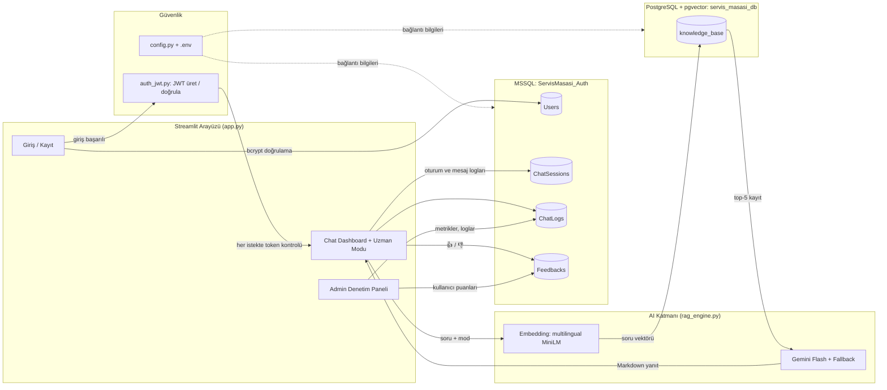
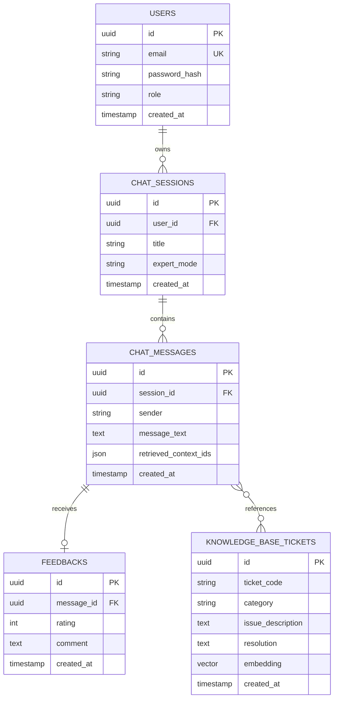
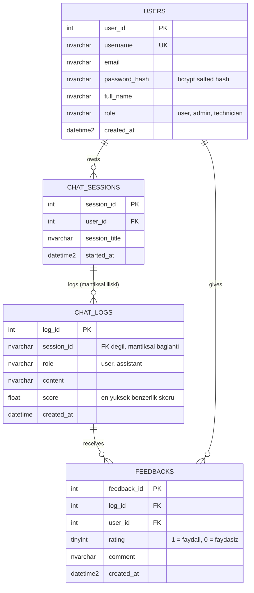
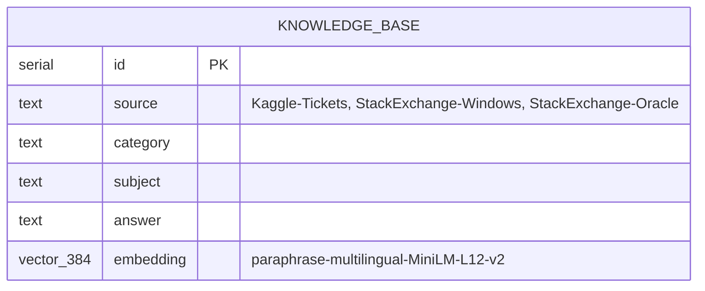
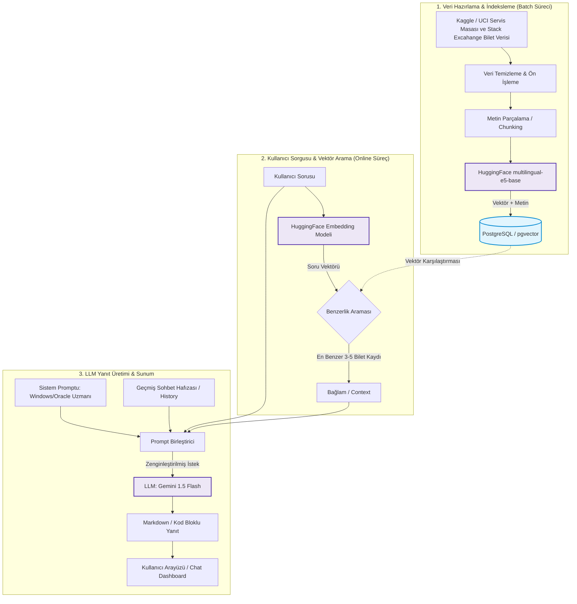
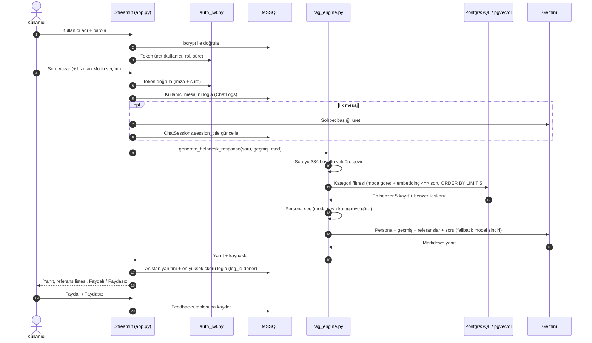

# Akıllı Servis Masası Chatbot

> **TRtek Yazılım — Proje No: PRJIC20260201**
> Servis masası (ticket) kayıtlarını ve Windows Server / Oracle DB teknik soru-cevaplarını bir bilgi tabanına dönüştüren, **RAG (Retrieval-Augmented Generation)** mimarisiyle çalışan, Türkçe konuşan bir **Yapay Zeka Destek Mühendisi**.


---

## İçindekiler

1. [Proje Hakkında](#proje-hakkında)
2. [Özellikler](#özellikler)
3. [Teknoloji Yığını](#teknoloji-yığını)
4. [Sistem Mimarisi](#sistem-mimarisi)
5. [ER Diyagramı](#er-diyagramı)
6. [RAG Diyagramı](#rag-diyagramı)
7. [Model Seçimi ve Nedenleri](#model-seçimi-ve-nedenleri)
8. [Veri Setleri ve Veri Hazırlama](#veri-setleri-ve-veri-hazırlama)
9. [Kurulum](#kurulum)
10. [Kullanım](#kullanım)
11. [Proje Yapısı](#proje-yapısı)
12. [Güvenlik ve Kimlik Doğrulama (JWT)](#güvenlik-ve-kimlik-doğrulama-jwt)
13. [Başarı Oranı Metriği](#başarı-oranı-metriği)
14. [Proje Gereksinimleri Durumu](#proje-gereksinimleri-durumu)
15. [Test Raporu](#test-raporu)
16. [Sınırlılıklar ve Yol Haritası](#sınırlılıklar-ve-yol-haritası)

---

## Proje Hakkında

Bu proje, bir yazılım şirketinin teknik destek ve sistem yönetimi süreçlerini otomatize etmeyi amaçlar. Chatbot:

- Açık kaynaklı servis masası talep kayıtlarını (ticket) analiz ederek **benzer sorunlara çözüm** üretir,
- Kurumsal altyapının temel taşları olan **Windows Server** (Active Directory, IIS, Event Log) ve **Oracle DB** (SQL optimizasyonu, Tablespace, Backup/Restore) konularında derinlemesine teknik destek sunar,
- Yanıtlarını bulunan kaynak kayıtlara dayandırır ve kullanılan referansları kullanıcıya gösterir.

Kullanıcı bir soru sorduğunda sistem önce vektör veritabanından benzer kayıtları bulur, ardından bu kayıtları **bağlam (context)** olarak LLM'e verir ve Markdown / kod bloklu bir yanıt üretir.

## Özellikler

| Alan | Özellik |
|------|---------|
|  **Kimlik doğrulama** | Kayıt / giriş, e-posta format kontrolü, parola karmaşıklığı (min. 8 karakter, büyük + küçük harf, rakam), **bcrypt (salted hash)**, **özgün JWT (HS256) yetkilendirmesi** |
|  **Erişim kontrolü** | Token süresi ve imza doğrulaması, rolün token'dan okunması, sohbet geçmişine yalnızca oturum sahibinin erişmesi |
|  **Chat Dashboard** | Çoklu sohbet oturumu, geçmiş sohbet listesi, yeni sohbet başlatma, Gemini ile otomatik **sohbet başlığı** |
|  **RAG** | pgvector üzerinde kosinüs benzerliğiyle en yakın 5 kayıt; kaynak, kategori ve benzerlik skoru ile birlikte gösterim |
|  **Sistem Uzmanı Modu** | Kenar çubuğundan **Otomatik / Genel / Windows Server / Oracle DB** seçimi; seçilen moda göre kategori filtresi ve uzman persona |
|  **Konuşma hafızası** | Önceki mesajlar LLM istemine eklenerek bağlam sürdürülür |
|  **Markdown çıktı** | SQL, PowerShell, RMAN komutları kod bloğu içinde gösterilir |
|  **Model yedekleme** | Birden fazla Gemini modeli arasında fallback; çoklu API anahtarı desteği |
|  **Geri bildirim** | Her yanıtta **Faydalı / Faydasız** puanlama; oylar `Feedbacks` tablosuna kaydedilir |
|  **Admin paneli** | Toplam yanıt, ortalama benzerlik, **kullanıcı puanı + benzerlik tabanlı başarı oranı**, en çok sorulan sorular, detaylı log tablosu |
|  **Tema uyumu** | Mesaj balonları yarı saydam renklerle açık ve koyu (Dark Mode) temada okunaklı |
|  **Hızlı yardım** | "Şifremi unuttum", "VPN'e bağlanamıyorum", "Yazıcı çalışmıyor" kısayolları, "Soruyu tekrar sor" |

## Teknoloji Yığını

| Katman | Teknoloji |
|--------|-----------|
| Arayüz | **Streamlit** (Python) |
| Embedding | **HuggingFace** `sentence-transformers/paraphrase-multilingual-MiniLM-L12-v2` (384 boyut) |
| Vektör deposu | **PostgreSQL + pgvector** (`<=>` kosinüs mesafesi) |
| Kullanıcı / log deposu | **Microsoft SQL Server** (`pyodbc`, ODBC Driver 17) |
| LLM | **Google Gemini** (`google-genai`), fallback modelli |
| Güvenlik | **bcrypt**, özgün **JWT (HS256)** (`hmac`, `hashlib`, `base64`) |
| Yapılandırma | `.env` + `config.py` (`python-dotenv`) |
| Veri işleme | **pandas**, HuggingFace `datasets` (streaming) |
| Altyapı | **Docker** (PostgreSQL ve MSSQL konteynerleri) |

## Sistem Mimarisi

Uygulama iki ayrı veritabanı kullanır: **ilişkisel/vektörel bilgi tabanı** PostgreSQL'de, **kullanıcı yönetimi, loglama ve geri bildirim** MSSQL'de tutulur.



---

# ER DİYAGRAMI



> Yukarıdaki diyagram, proje başlangıç kriteri olarak teslim edilen **hedef (tasarım) veri modelidir**. Aşağıdaki diyagramlar ise koddaki **güncel fiziksel şemayı** gösterir.

## Uygulanan Veritabanı Şeması

Kullanıcı, oturum, log ve geri bildirim verisi **MSSQL**'de (`ServisMasasi_Auth`), bilgi tabanı **PostgreSQL (pgvector)**'de (`servis_masasi_db`) tutulur. Tablolar `init_mssql.sql` ile oluşturulur.





| Tasarım (hedef) | Uygulama (mevcut) |
|---|---|
| `USERS` | `Users` (MSSQL) |
| `CHAT_SESSIONS` | `ChatSessions` (MSSQL) |
| `CHAT_MESSAGES` | `ChatLogs` (MSSQL) |
| `FEEDBACKS` | `Feedbacks` (MSSQL), `log_id` ve `user_id` yabancı anahtarlı, `rating` yalnızca 0/1 |
| `KNOWLEDGE_BASE_TICKETS` | `knowledge_base` (PostgreSQL + pgvector) |

---

# RAG DİYAGRAMI


> Yukarıdaki diyagram teslim edilen **hedef RAG akışıdır**. Uygulamada embedding modeli `paraphrase-multilingual-MiniLM-L12-v2` (384 boyut) ve LLM, fallback zincirli bir Gemini Flash modelidir. Metin parçalama adımı henüz uygulanmamıştır ([Yol Haritası](#sınırlılıklar-ve-yol-haritası)).

## Uygulanan RAG Akışı (Sıra Diyagramı)



## Model Seçimi ve Nedenleri

| Bileşen | Seçim | Neden |
|---------|-------|-------|
| **LLM** | Google Gemini Flash ailesi (birden fazla modelle fallback) | Hızlı yanıt süresi, Türkçe ve kod üretiminde (SQL, PowerShell) güçlü performans, ücretsiz/düşük maliyetli erişim; model hata verirse bir sonrakine geçilebildiği için kesintisiz çalışma |
| **Embedding** | `paraphrase-multilingual-MiniLM-L12-v2` | Çok dilli (Türkçe sorgu ↔ İngilizce bilet/StackExchange kaydı eşleşmesi), 384 boyutlu olduğu için hafif ve hızlı, yerelde CPU üzerinde çalışabiliyor |
| **Vektör DB** | PostgreSQL + pgvector | Proje standardı; ilişkisel ve vektörel veri tek motorda, kosinüs mesafesi operatörü (`<=>`) hazır |

---

## Veri Setleri ve Veri Hazırlama

| Kaynak | İçerik | Kodda kullanılan ad |
|--------|--------|---------------------|
| [Kaggle — Multilingual Customer Support Tickets](https://www.kaggle.com/datasets/tobiasbueck/multilingual-customer-support-tickets) | Sınıflandırılmış BT destek kayıtları | `Kaggle-Tickets` |
| [HuggingFace — Stack Exchange Preferences](https://huggingface.co/datasets/HuggingFaceH4/stack-exchange-preferences) | Server Fault (Windows Server) ve DBA StackExchange (Oracle) soru-cevapları | `StackExchange-Windows`, `StackExchange-Oracle` |

### Hazırlama adımları

1. **Ticket verisi temizleme**: `scripts/clean_tickets.py`
   - Yalnızca İngilizce kayıtlar; yalnızca BT ile ilgili kuyruklar (`Technical Support`, `IT Support`, `Service Outages and Maintenance`)
   - Boş `body` / `answer` kayıtlarının atılması, çözüm metni en az 100 karakter
   - Anonimleştirme yer tutucularının (`<name>`, `<tel_num>` vb.) bulunduğu kayıtların elenmesi
   - Tekrarlı kayıtların silinmesi, etiketlerin tek sütunda birleştirilmesi
2. **StackExchange verisi çekme**: `scripts/stackexchange.py`
   - 22 GB'lık veri seti **streaming** ile indirilmeden taranır
   - Anahtar kelime filtresi (Active Directory, IIS, GPO, Event Log / Oracle, Tablespace, RMAN, ORA-xxxxx vb.)
   - En yüksek puanlı cevap seçilir, HTML temizlenir, kod blokları ` ``` ` ile korunur
3. **Vektörleştirme ve yükleme**: `import_3_csv.py`
   - Metin `Uzmanlık Kategorisi | Konu | Çözüm` formatında birleştirilip embedding'e çevrilir
   - `knowledge_base` tablosuna yazılır

---

## Kurulum

### Gereksinimler

- Python 3.10+
- Docker
- [ODBC Driver 17 for SQL Server](https://learn.microsoft.com/sql/connect/odbc/download-odbc-driver-for-sql-server)
- [Google AI Studio](https://aistudio.google.com/) API anahtarı

### 1. Depoyu klonlayın

```bash
git clone https://github.com/bayramogluhavvanur/Akilli-Servis-Masasi-Chatbot.git
cd Akilli-Servis-Masasi-Chatbot
python -m venv venv
# Windows: venv\Scripts\activate   |   Linux/macOS: source venv/bin/activate
```

### 2. Bağımlılıkları yükleyin

```bash
pip install streamlit pandas psycopg2-binary sentence-transformers pyodbc bcrypt python-dotenv google-genai datasets
```

> JWT özgün olarak yazıldığı için ek bir JWT kütüphanesi gerekmez.

### 3. Veritabanlarını Docker ile başlatın

```bash
# PostgreSQL + pgvector
docker run -d --name rag-postgres -p 5432:5432 \
  -e POSTGRES_PASSWORD=admin123 -e POSTGRES_DB=servis_masasi_db \
  pgvector/pgvector:pg16

# Microsoft SQL Server
docker run -d --name mssql-server -p 1433:1433 \
  -e ACCEPT_EULA=Y -e "MSSQL_SA_PASSWORD=ServisMasasi2026!" \
  mcr.microsoft.com/mssql/server:2022-latest
```

> Parolalar örnektir. Kendi ortamınızda güçlü parolalar kullanın ve `.env` dosyasına aynısını yazın.

### 4. Ortam değişkenlerini ayarlayın

Proje kök dizininde `.env` dosyası oluşturun. Bu dosya `.gitignore` içindedir, repoya girmez:

```env
# PostgreSQL
PG_PASSWORD=admin123

# MSSQL
MSSQL_PASSWORD=ServisMasasi2026!

# JWT gizli anahtarı (aşağıdaki komutla üretin)
JWT_SECRET=uretilen_uzun_rastgele_deger

# Gemini (tek anahtar veya yedekli çoklu anahtar)
GEMINI_API_KEY_1=your_api_key_1
GEMINI_API_KEY_2=your_api_key_2

# İsteğe bağlı: bilgi tabanı tablo adı (varsayılan: knowledge_base)
# KB_TABLE=knowledge_base
```

JWT gizli anahtarı üretmek için:

```bash
python -c "import secrets; print(secrets.token_hex(32))"
```

### 5. MSSQL şemasını oluşturun

`init_mssql.sql` tekrar çalıştırılabilir (idempotent) yazılmıştır; tabloları yalnızca yoksa oluşturur ve mevcut veriye dokunmaz.

```bash
docker cp init_mssql.sql mssql-server:/tmp/init_mssql.sql
docker exec mssql-server /opt/mssql-tools18/bin/sqlcmd -S localhost -U sa -P "<sa_parolasi>" -C -i /tmp/init_mssql.sql
```

Betik `Users`, `ChatSessions`, `ChatLogs` ve `Feedbacks` tablolarını oluşturur.

### 6. Veri setlerini hazırlayın ve bilgi tabanını doldurun

```bash
# Ticket verisini temizle (Kaggle CSV'sini data/ klasörüne koyun)
python scripts/clean_tickets.py

# StackExchange verilerini çek
python scripts/stackexchange.py --site serverfault.com --category windows_server
python scripts/stackexchange.py --site dba.stackexchange.com --category oracle

# Vektörleştir ve PostgreSQL'e yükle
python import_3_csv.py
```

> `import_3_csv.py` çalışırken `knowledge_base` tablosunu **TRUNCATE** eder; tekrar çalıştırmak mevcut verileri sıfırlar.
> Script, `data/kaggle_tickets.csv`, `data/se_windows.csv` ve `data/se_oracle.csv` dosyalarını bekler. Dosya adları farklıysa yeniden adlandırın.

### 7. Admin parolasını belirleyin

`init_mssql.sql` içindeki `admin` kullanıcısı parola olmadan (`RESET_REQUIRED`) eklenir ve bcrypt ile doğrulanamaz. İlk girişten önce `reset_my_password.py` içindeki `KULLANICI_ADI` / `YENI_SIFRE` değerlerini düzenleyip çalıştırın (en az 8 karakter, büyük + küçük harf, rakam):

```bash
python reset_my_password.py
```

### 8. Uygulamayı başlatın

```bash
streamlit run app.py
```

Tarayıcıda `http://localhost:8501` adresi açılır.

---

## Kullanım

1. **Kayıt ol** sekmesinden hesap oluşturun (geçerli e-posta, min. 8 karakter, büyük + küçük harf + rakam).
2. **Giriş yapın**; sistem imzalı bir JWT üretir ve son sohbetiniz açılır.
3. Sol panelden **Uzman Modu**'nu seçin:
   - **Otomatik**: Bulunan kayıtların kategorisine göre uzman rolü seçilir
   - **Genel**: Servis masası asistanı
   - **Windows Server**: Yalnızca Windows kayıtları + Windows uzmanı rolü
   - **Oracle DB**: Yalnızca Oracle kayıtları + DBA rolü
4. Sorunuzu yazın, örneğin:
   - `ORA-00942 table or view does not exist hatası alıyorum, nasıl düzeltebilirim?`
   - `Active Directory'de kilitli kullanıcı hesaplarını PowerShell ile nasıl listelerim?`
   - `IIS'te uygulama havuzu sürekli duruyor, Event Log'da nereye bakmalıyım?`
5. Yanıtın altındaki **Referans Dokümanlar** bölümünden kaynak, kategori ve benzerlik skorunu görün; **Faydalı / Faydasız** ile puanlayın.
6. Sol panelden **Geçmiş Sohbetlerim** arasında gezinin veya **Yeni Sohbet Başlat** ile yeni oturum açın.
7. `admin` rolündeki kullanıcılar sol panelde **Admin Denetim Paneli**'ne geçebilir.

### Hızlı arama testi

Gemini'ye gitmeden yalnızca vektör aramayı test etmek için:

```bash
python search_test.py
```

---

## Proje Yapısı

```
Akilli-Servis-Masasi-Chatbot/
├── app.py                  # Streamlit arayüzü: giriş/kayıt, chat dashboard, admin paneli
├── rag_engine.py           # RAG çekirdeği: vektör arama, uzman modu, prompt, Gemini çağrıları
├── prompts.py              # Sistem promptları (genel / Windows Server / Oracle DB)
├── db_mssql.py             # MSSQL katmanı: kullanıcı, bcrypt, oturum, log, geri bildirim, metrikler
├── auth_jwt.py             # Özgün JWT (HS256) üretimi ve doğrulaması
├── config.py               # .env üzerinden veritabanı ve JWT yapılandırması
├── import_3_csv.py         # CSV'leri embedding'e çevirip PostgreSQL'e yükler
├── ingest.py               # Alternatif/ilk sürüm yükleyici (zengin şema, all-MiniLM-L6-v2)
├── init_mssql.sql          # MSSQL veritabanı ve tablo scriptleri (tekrar çalıştırılabilir)
├── reset_my_password.py    # Kullanıcı parolasını bcrypt ile sıfırlama yardımcısı
├── search_test.py          # Vektör arama test scripti
├── test_model.py           # API anahtarıyla erişilebilen Gemini modellerini listeler
├── main.py                 # FastAPI başlangıç taslağı
├── scripts/
│   ├── clean_tickets.py    # Kaggle ticket verisi temizleme
│   └── stackexchange.py    # StackExchange verisi çekme (streaming)
├── requirements.txt
└── .gitignore
```

---

## Güvenlik ve Kimlik Doğrulama (JWT)

- **Parola saklama:** Parolalar `bcrypt` ile **salted hash** olarak saklanır; geri döndürülemez, doğrulama `bcrypt.checkpw` ile yapılır.
- **Girdi doğrulama:** E-posta formatı ve parola karmaşıklığı kayıt sırasında zorunludur; tekrarlı kullanıcı adı ve e-posta engellenir.
- **Özgün JWT:** Hazır JWT kütüphanesi kullanılmadan, `hmac` + `hashlib` + `base64` ile **HS256** imzalı token üretilir (`auth_jwt.py`). Token; kullanıcı ID'si, kullanıcı adı, rol, oluşturulma ve bitiş zamanını içerir (geçerlilik: 1 saat).
- **Doğrulama:** Uygulama her çalışmada token'ın imzasını (`hmac.compare_digest`, sabit süreli karşılaştırma) ve süresini doğrular. Geçersiz veya süresi dolmuş token'da kullanıcı oturumdan çıkarılır ve uyarı görür.
- **Rol tabanlı erişim:** Admin paneli yetkisi, istemci tarafı bir değişkenden değil **imzalı token'daki rolden** okunur.
- **Sohbet izolasyonu:** `get_session_messages(session_id, user_id)` sorgusu oturumu `user_id` ile eşleştirir; başka kullanıcının oturum numarası bilinse bile mesajlar döndürülmez.
- **SQL enjeksiyonu:** Sorgular parametrik (`?` / `%s`) çalıştırılır.
- **Gizli bilgiler:** Veritabanı parolaları, JWT anahtarı ve API anahtarları `.env` dosyasında tutulur ve `.gitignore` ile repo dışında bırakılır.

> **Not:** Token, Streamlit'in sunucu tarafındaki oturum durumunda (`session_state`) tutulur. Tam bir REST senaryosunda token her istekte `Authorization` başlığıyla taşınır. Mevcut yapı, doğrulama ve yetki mantığını bu hâle taşımaya hazır tasarlanmıştır (bkz. Yol Haritası).

---

## Başarı Oranı Metriği

Admin panelindeki **Başarı Oranı**, kullanıcı geri bildirimi ile benzerlik skorunu birleştirir:

- Kullanıcı bir yanıtı **puanladıysa**: Faydalı = başarılı, Faydasız = başarısız
- Kullanıcı **puanlamadıysa**: en yüksek benzerlik skoru **≥ 0.75** ise başarılı

Panelde, kaç yanıtın kullanıcı puanıyla, kaçının benzerlik skoruyla değerlendirildiği de gösterilir. Böylece az sayıda oy olsa bile metrik boş kalmaz, oy sayısı arttıkça gerçek memnuniyete yaklaşır.

---

## Proje Gereksinimleri Durumu

| Gereksinim | Durum | Not |
|------------|:----:|-----|
| Veri temizleme ve bilgi tabanı oluşturma | ✅ | `scripts/` + `import_3_csv.py` |
| Embedding ve pgvector'e kayıt | ✅ | 384 boyutlu çok dilli model |
| Benzer kayıt bulma ve LLM'e bağlam verme | ✅ | Top-5, kosinüs benzerliği |
| Windows Server / Oracle DB uzmanlığı | ✅ | Kategoriye göre persona + `prompts.py` |
| Sistem Uzmanı Modu | ✅ | Otomatik / Genel / Windows Server / Oracle DB seçici |
| Önceki mesajları hatırlama | ✅ | Konuşma geçmişi LLM istemine eklenir |
| Markdown / kod bloğu çıktısı | ✅ | |
| Kullanıcı kaydı, e-posta ve parola kuralları | ✅ | |
| Salted hash ile parola saklama | ✅ | bcrypt |
| JWT ile özgün yetkilendirme | ✅ | `auth_jwt.py`, HS256, süre ve imza doğrulaması |
| Yetkisiz kullanıcının sohbet geçmişine erişimi engelleme | ✅ | `user_id` ile sahiplik kontrolü |
| Yanıt puanlama | ✅ | `Feedbacks` tablosuna kayıt |
| Admin raporlama paneli | ✅ | Başarı oranı (puan + benzerlik), en çok sorulan sorular, loglar |
| Dark Mode destekli tema | ✅ | Yarı saydam, tema uyumlu mesaj balonları |
| Bilgi Merkezi (Knowledge Base) yönetim ekranı | ❌ | Veri yükleme şu an komut satırından |
| Chunking (metin parçalama) | ❌ | Kayıtlar bütün olarak vektörleştiriliyor |
| Dockerfile | ❌ | İsteğe bağlı |

✅ Tamamlandı · ❌ Planlanan

---

## Test Raporu

**Test tarihi:** 23/10/2026 · **Kapsam:** 20 senaryo (10 servis masası, 5 Windows Server, 5 Oracle DB)
**Değerlendirme:** "RAG Eşleşme Skoru" yanıtın doğruluğunu değil, sorunun bilgi tabanındaki kayıtlara benzerliğini gösterir. Başarı kararı yanıt içeriğine göre verilmiştir.

### Özet

| Bölüm | Senaryo | Ortalama skor | En düşük | En yüksek |
|---|:--:|:--:|:--:|:--:|
| Servis Masası | 10 | 0.601 | 0.410 | 0.694 |
| Windows Server | 5 | 0.667 | 0.575 | 0.750 |
| Oracle DB | 5 | 0.683 | 0.575 | 0.797 |
| **Genel** | **20** | **0.638** | 0.410 | 0.797 |

### Servis Masası

| # | Soru (özet) | Skor |
|---|-------------|:----:|
| 1 | Yazıcıdan çıktı alamıyorum, yazdırma kuyruğu takıldı | 0.4100 |
| 2 | Outlook e-postaları senkronize olmuyor | 0.5478 |
| 3 | VPN bağlantısında "Remote Desktop Gateway" hatası | 0.6500 |
| 4 | Active Directory üzerinden şifre sıfırlama | 0.5020 |
| 5 | Ağ paylaşımlı klasöre tek kullanıcı erişemiyor | 0.6620 |
| 6 | Bozuk (corrupted) Excel dosyasını kurtarma | 0.6038 |
| 7 | Kurumsal web tarayıcıda SSL sertifika uyarısı | 0.6864 |
| 8 | Masaüstü uygulama açıldıktan hemen sonra kapanıyor | 0.5730 |
| 9 | Microsoft Teams ses ve mikrofon sorunu | 0.6827 |
| 10 | Yazılım kurmak için geçici yönetici yetkisi | 0.6937 |

### Windows Server

| # | Soru (özet) | Skor |
|---|-------------|:----:|
| 1 | AD'de kilitli hesapları PowerShell ile listeleme ve kilit açma | 0.5948 |
| 2 | IIS uygulama havuzu duruyor, 503 hatası | 0.7110 |
| 3 | Event Viewer'da son 24 saatin kritik/hata olaylarını filtreleme | 0.5747 |
| 4 | Group Policy'nin istemciye uygulanıp uygulanmadığını kontrol | 0.7055 |
| 5 | Domain Controller replikasyon ve DNS sorunları | 0.7503 |

### Oracle DB

| # | Soru (özet) | Skor |
|---|-------------|:----:|
| 1 | Yavaş SQL sorgusunun execution plan'ı ve optimizasyonu | 0.7966 |
| 2 | ORA-00942 table or view does not exist | 0.6567 |
| 3 | ORA-01653 unable to extend table, tablespace kontrolü | 0.7228 |
| 4 | RMAN ile tam yedek ve geri dönüş | 0.6647 |
| 5 | Data Pump (expdp/impdp) ile şema aktarımı | 0.5745 |

### Bulgular

- Windows Server ve Oracle DB soruları, genel servis masası sorularından daha yüksek skor almıştır; bu alanlarda bilgi tabanı StackExchange'in ayrıntılı teknik cevaplarıyla beslenmektedir.
- En düşük skor yazıcı sorununda (0.41) görülmüştür. Servis masası kayıtları büyük oranda İngilizce ve kısa olduğundan Türkçe, günlük dille yazılmış sorularda eşleşme zayıflamaktadır.
- Yanıtlar Markdown biçiminde, komut ve kod bloklarıyla (PowerShell, SQL, RMAN) sunulmuş ve referanslar kullanıcıya gösterilmiştir.

---

## Sınırlılıklar ve Yol Haritası

**Sınırlılıklar**

- Bilgi tabanı büyük ölçüde İngilizce olduğu için Türkçe sorgularda benzerlik skorları orta seviyede kalmaktadır.
- Kayıtlar parçalara bölünmeden vektörleştirildiği için uzun cevapların bir kısmı embedding modeli tarafından görülmemektedir (model uzun metinleri keser).
- Token, Streamlit sunucu oturumunda tutulduğundan sayfa tamamen yenilendiğinde yeniden giriş gerekir.

**Yol haritası**

- [ ] Chunking ve uzun kayıtlar için parça bazlı arama
- [ ] Bilgi Merkezi yönetim ekranı (CSV yükleme, otomatik embedding, kaynak silme)
- [ ] Servis masası verisinin Türkçe örneklerle zenginleştirilmesi
- [ ] FastAPI katmanı: `/auth/login`, `/auth/register`, `/chat` uç noktaları ve `Authorization` başlıklı JWT kullanımı
- [ ] Dockerfile / docker-compose ile tek komutla kurulum
- [ ] Daha güçlü çok dilli embedding modeli (ör. `multilingual-e5-base`) ile karşılaştırmalı test

---

## Lisans ve İletişim

Bu proje TRtek Yazılım staj projesi kapsamında geliştirilmiştir.
Geliştirici: [@bayramogluhavvanur](https://github.com/bayramogluhavvanur)
